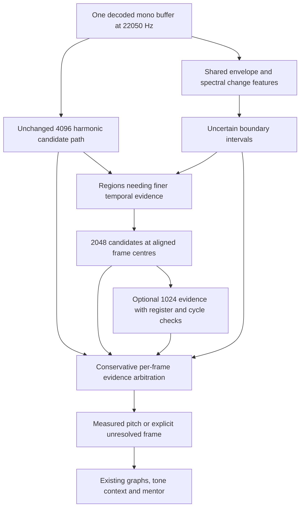

# Phase 2D.2 — Proposed multi-resolution pitch architecture

This is an implementation plan, **not a replacement engine shipped in Phase 2D.1**. Read the [quantitative audit](fast-passage-pitch-audit.md) first. The evidence rules out simply replacing 4096 with 1024 samples or lowering harmonic support until the graph fills.

## Design contract

Preserve the current 4096/512/22050 path as a versioned, independently testable baseline. Existing recording, microphone, player, storage, playlists, tone and mentor features continue through the same recording-scoped analysis session and worker lifecycle. New estimates must retain their evidence and uncertainty. No interpolation, nearest-note snapping, expected Bach sequence, or professional-performance target is allowed.

The acceptance decision must separate:

1. A window contains enough evidence for a pitch candidate.
2. Multiple resolutions agree about the same moment in time.
3. There is evidence of a boundary or changing/overlapping spectrum.
4. A musical interpretation is supported by the resulting trajectory.

A boundary cue cannot create pitch evidence. Agreement is not a calibrated confidence probability. Pitch tracking must remain independent of the student's practice goal or intended score note.

## Proposed data flow



### 1. Introduce a diagnostic candidate interface without changing results

First refactor behind a versioned analysis configuration so the existing path returns exactly the same outputs. Proposed evidence fields:

```ts
type ResolutionEvidence = {
  centreSample: number;
  windowSamples: 4096 | 2048 | 1024;
  intervalSamples: [number, number];
  rawFrequency: number | null;
  candidates: PitchCandidate[];
  candidateGateFailures: string[][];
  trackerDecision: string;
  intersectsBoundary: boolean | null;
};
type BoundaryEvidence = {
  intervalSamples: [number, number];
  cues: ("flux" | "envelope" | "spectral-change")[];
  status: "proposal" | "unresolved";
};
```

Use integer sample indices internally to avoid cross-resolution timestamp drift. Start with the existing 512-sample pitch grid; the 256-sample tone-feature grid supplies finer boundary timing. Avoid adding extra temporal resolution until measured benefits justify its cost. Keep `PitchFrame.frequency`, nullable gaps and diagnostics compatible, adding versioned source-window and arbitration fields rather than altering storage schemas.

Expose separate missing reasons: quiet; no in-range seeds; support/score/periodicity/primitive failure; ineligible rank winner; insufficient margin; insufficient cycles; boundary overlap; cross-resolution disagreement. Retain raw Pitchy reasons separately. Do not describe every failed harmonic decision as low Pitchy clarity.

### 2. Build and evaluate a separate boundary-evidence layer

Reuse or extract the numerical spectral-flux/envelope calculations into a common feature module so both tone and pitch can consume them without decoding or transforming the same data unnecessarily. Preserve the existing tone-output version while establishing equivalence; do not use its classified event list as a required gate.

Evaluate boundary proposals using:

- Short-window spectral change, including separate low and upper spectral bands so persistent low resonance does not hide a changing upper register.
- Envelope slope/attack/dip evidence independent of magnitude-normalised flux, including repeated-note attacks with little spectral-shape change.
- Local/background-aware threshold alternatives evaluated against the current global median + 4 MAD baseline. Dense fast passages need an explicit test because the old threshold can exceed the observed maximum.
- Shorter suppression intervals chosen from labelled boundary performance, not the existing 250 ms articulation-event spacing. The audit's 30 ms picker is a comparator, not an approved threshold.

Output an interval of uncertainty around each proposal, not a physical bow-change label. Evaluate onset precision, recall, duplicate proposals, timing bias and false positives on sustained/vibrato/noise controls before using boundaries in pitch arbitration. Segmentation must remain possible when pitch is missing; do not create a circular dependency on the trajectory being repaired.

### 3. Add aligned 2048/1024 candidate passes offline first

Run all three resolutions in an experiment mode first to expose disagreements. Keep local spectral support/periodicity requirements; do not assume score or margin distributions are comparable across window sizes. The absolute harmonic-match tolerance currently widens fourfold at 1024 and must be calibrated separately on development data.

Initial policy to test:

- Retain 4096 for low-register and stable passages with adequate evidence and no boundary crossing.
- Ask 2048 for finer evidence where the long window is withheld or crosses a boundary proposal. This should be the first short-resolution option, given the stronger 1024 regressions.
- Consider 1024 only when its own candidate has enough cycles and strong independent harmonic evidence, and 2048/boundary evidence does not contradict it. A provisional minimum of six periods would restrict 1024 to approximately 129 Hz and above; this is a hypothesis to validate, not a universal accuracy threshold. A3 remains a warning: enough cycles alone did not prevent its observed regression.
- If the register cannot be established reliably, retain the long-window result or leave the frame unresolved. Do not let an unverified short-window F0 establish its own eligibility by implying a higher register.
- Avoid treating two resolutions of the same audio as statistically independent confirmations. Never discard the long-window path purely because a shorter one reports higher clarity or more accepted frames.

Initially compute in one cancellable worker over copied audio. Retain only necessary candidate arrays, process in chunks, report progress, and check recording/job identity before publishing. Goal changes must continue to reuse the completed analysis; switching recordings must cancel old work and release buffers.

### 4. Implement conservative arbitration and boundary-aware tracking

Use explicit deterministic rules before considering a probabilistic sequence model:

1. Keep a strong baseline estimate within a stable segment unless independent evidence establishes that its window spans changing content.
2. A shorter-window estimate can replace a baseline gap only if it passes its own gates and has compatible nearby evidence within the same proposed segment. Retain per-resolution candidates, disagreements and reasons in diagnostics.
3. On disagreement, prefer abstention over an unsupported octave choice. Evaluate harmonic/subharmonic relationships and residual unexplained peaks. Do not simply choose the estimate nearest the previous note.
4. Clip neighbour influence at a plausible boundary so old-note support does not propagate through a real change. Preserve the bounded influence of current-frame evidence and test legitimate octave changes, vibrato and glissandi.
5. Mark changing/overlapping content as unresolved when no single harmonic family is defensible. Do not claim source separation or interpolate across a resonance tail.

Neighbour bonuses and eligibility checks must be calibrated with errors as well as coverage. The current top-ineligible/runner-eligible case should receive a distinct diagnostic; automatically selecting the runner-up requires separate evidence, not a convenience fix.

Preserve raw and corrected overlays and rejection inspection. The mentor must still distinguish insufficient contiguous data from available measurements with no qualifying offset/drift pattern. Fast passages do not automatically meet the mentor's sustained-note requirements.

### 5. Validate with explicit datasets and denominators

Freeze the Phase 2D.1 outputs as a baseline. Extend the existing benchmark with randomised **held-out** pitches, tempi, onset phases, harmonic envelopes, noise, reverberation and overlapping decay times. Separate generator seeds/configurations used for design from evaluation. Include true octave changes, close semitone transitions, repeated notes, silence and transients. Do not tune expected sequences into the runtime.

Before reporting real fast-passage accuracy, obtain independently reviewed labels for the Bach excerpt and additional dry/reverberant cello takes. Record note onsets, intended/verified pitch information, uncertain/polyphonic intervals, tuning reference, annotation method and inter-annotator disagreement. Exclude uncertain target-frequency intervals from accuracy denominators explicitly and report their extent. Never evaluate against the output of the proposed engine itself.

Required metrics by register, tempo, texture, distance from boundary and recording:

- Correct/all, wrong/all, withheld/all, accepted accuracy, octave/subharmonic errors, previous-note persistence and rejected reasons.
- Cents median/95th percentile on labelled single-note portions; separately report transition/tail errors and matched-centre comparisons.
- Boundary precision/recall and signed/absolute timing error at predeclared tolerances (25/50/100 ms), with one-to-one matching and unmatched events retained.
- Target-conditioned new-pitch response with missed-note counts; do not confuse this with independent onset detection.
- Wall-clock time, peak memory, worker cancellation responsiveness and mobile-browser responsiveness. Benchmark the complete decode + pitch + tone path as well as individual resolutions.

Frames overlap, so confidence intervals should resample independent recordings/notes rather than treating thousands of overlapping frames as independent observations.

### 6. Proposed release gates and rollout

Agree and freeze these gates before evaluating the held-out set:

- Existing typecheck, lint, tests and production build pass. All microphone/playback/IndexedDB/playlist/feedback cancellation regressions pass.
- No new wrong-note frames in the original labelled open-string regions, and no reduction in their baseline correct-frame counts. Keep the existing A-string bow-change, C2 harmonic and D3-coverage regression assertions. New held-out sustained-cellist recordings must also show no meaningful loss; one open-string sample is insufficient proof.
- On clean 80/125 ms synthetic passages, seek at least a 15-percentage-point gain in correct/all over the 4096 baseline **without increasing wrong/all by more than one percentage point**. Treat this as a proposed acceptance target, not a demonstrated result. The raw short-window runs in this audit do not meet that error guardrail across all cases.
- Seek 95th-percentile absolute response ≤50 ms on clean 125 ms passages while retaining all note responses; report failures separately for resonance/noise rather than weakening the criterion or hiding misses.
- Do not release a boundary-dependent selection rule until held-out boundary precision/recall and false positives on sustained controls are measured. Coverage increases alone are insufficient.
- Keep the old version available as a rollback/reference path. Ship behind a local analysis-version switch first, with truthful diagnostics. Browser-check current Chrome/Safari and narrow layouts before making it default.

Implementation order: diagnostic interface and equivalence tests → independent boundary benchmark → offline multi-resolution candidates → conservative arbitration → complete worker/graph/mentor integration → held-out evaluation and browser checks → explicit release decision. Each stage produces reviewable numerical comparisons; failure of a preservation gate blocks default rollout.

## Deliverables for Phase 2D.2

1. Versioned shared candidate/boundary types and a backwards-compatible worker result.
2. Boundary evaluation corpus and metric report, including failures.
3. Multi-resolution experiment and arbitration implementation with per-frame provenance.
4. Updated graphs/diagnostics without changing recording or playlist schemas.
5. Reproduced Phase 2D.1 comparisons, sustained regressions, held-out labelled tests, timing/memory/cancellation measurements and browser checks.
6. A release recommendation based on error/coverage tradeoffs, not a visually fuller graph.
