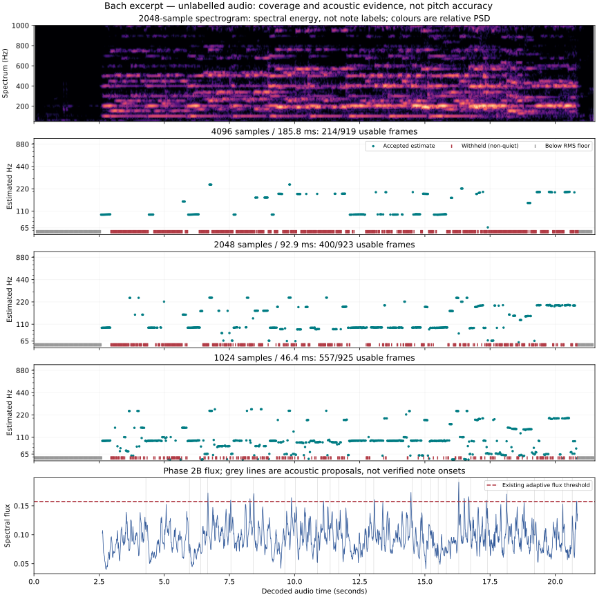
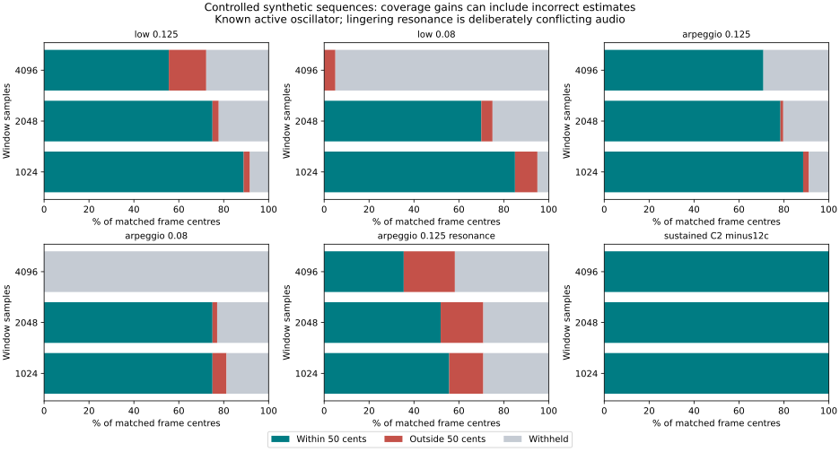

# Phase 2D.1 — Fast-passage pitch detection audit

17 October 2026. Production baseline: `5843f191fb26d8307e4256f753d686f2cb7b6000`.

## Findings and decision

**Keep the production engine unchanged.** The supplied Bach excerpt has substantial non-quiet pitch gaps. The immediate cause is predominantly failure of harmonic-candidate eligibility, not the final ambiguity gate. Shorter windows improve coverage on this excerpt and correct-frame coverage on controlled fast sequences, but introduce errors and regress the original open-string recording. Coverage alone cannot select a replacement.

- Bach baseline: **214/919 usable frames (23.29%)**; **27.09% of non-quiet frames**. There are 129 quiet frames, 565 weak-evidence tracker decisions and 11 ambiguous decisions.
- In 563 of the 565 weak-evidence frames, the highest spectral-score candidate fails the 0.65 harmonic-support gate. Gate failures overlap; this is not an exclusive count of causes.
- Offline 2048/1024-sample experiments reach **43.34%/60.22% coverage**, but disagree by more than 50 cents with 13/27 of the long-window estimates that both runs accept. Neither run is ground truth for this excerpt.
- At 80 ms/note, the clean synthetic arpeggio has **0/48 correct frames** with 4096 samples, versus **36/48** for both shorter windows. The 1024 run accepts more wrong frames than the 2048 run.
- The real open-string A3 control regresses from **100 correct / 0 wrong / 4 withheld** at 4096 to **63 / 13 / 28** at 1024. Clean stationary synthetic tones alone would miss this regression.
- Existing tone measurements are useful inputs for boundary research, but the current event detector is unsuitable as a fast-note segmenter. Its adaptive flux threshold can exceed every flux value in a rapid sequence, and its 250 ms proposal separation caps event density near four per second.

The [Phase 2D.2 implementation plan](fast-passage-phase2d2-plan.md) proposes a protected long-window path plus selective shorter-window evidence and a separate boundary-evidence layer. It does not prescribe lower confidence thresholds or missing-frame interpolation.

## Recording, provenance and limits of ground truth

The uploaded `Yo-yo Ma Prelude Bach Recording.m4a` was available and analysed locally. The filename supplies the attribution; this audit does not independently verify the performer or recording provenance.

| Property | Value |
| --- | --- |
| SHA-256 | `109a8bf5d75dc11f3bc80bba170c4d1f27a14ec3999fa30bdcbba478b61c2082` |
| Source | Stereo AAC, 48 kHz; container duration 21.568 s |
| Analysis decode | 474,605 mono samples at 22,050 Hz; 21.524036 s |
| Decode method | FFmpeg 7.1.5, retain channels while resampling, then production `mixToMono`; no gain normalisation |
| Quiet leading region | Baseline frame centres 0.0929–2.5542 s are below the RMS gate |
| Labels | No independently verified note frequencies, note onsets or articulation timestamps supplied |

Container and decoded durations differ because of codec/container timing. All times below use the decoded signal. FFmpeg and browser resamplers may produce slightly different measurements. The original audio and decoded PCM are **not committed** or sent to external analysis services.

For the Bach recording, this audit can establish signal statistics, rejected-frame causes, cross-resolution disagreement and acoustic associations. **Correct/wrong pitch counts, cents accuracy, note-onset recall and onset timing error are unknown** and are stored as null rather than inferred from the score, filename or another detector.

## Source audit

Sources: [pitch.ts](../src/lib/pitch.ts), [pitch-candidates.ts](../src/lib/pitch-candidates.ts), [tone.ts](../src/lib/tone.ts), [decode-audio.ts](../src/lib/decode-audio.ts).

### Window geometry

All experiments keep the sample rate at 22,050 Hz and hop at 512 samples (**23.220 ms**). Windows are full-length only, without end padding; timestamps are their centres. The first/last half-window and any final incomplete hop are unmeasured. Shorter windows therefore have different total frame counts. Matched-centre comparisons use the 4096 run's centre grid for fairness.

| Window | Duration | C2 periods, 65.41 Hz | Native FFT spacing | Zero-padded FFT grid |
| --- | ---: | ---: | ---: | ---: |
| 4096 | 185.76 ms | 12.15 | 5.38 Hz | 1.35 Hz |
| 2048 | 92.88 ms | 6.07 | 10.77 Hz | 2.69 Hz |
| 1024 | 46.44 ms | 3.04 | 21.53 Hz | 5.38 Hz |

Zero padding improves interpolation/grid density; it does **not** supply the resolving power of a longer observation. At the 55 Hz lower limit, 1024 contains only 2.55 periods. Configuration validation requires at least two periods, which is a legality check, not evidence of sufficient accuracy.

A 125 ms note has no complete 185.76 ms window contained within it. At 80 ms per note, even a 2048 window exceeds one note's duration. A small hop creates more overlapping views; it does not remove this mixing. Overlapping frames are strongly correlated and are not independent statistical trials.

### Candidate generation and selection

1. Remove DC per frame; reject RMS below **0.003** (about −50.46 dBFS).
2. Retain Pitchy's raw estimate, with peak threshold **0.97**, clarity gate **0.9**, range **55–1000 Hz**, for diagnostics/refinement.
3. Independently calculate Hann-windowed spectral peaks to 3000 Hz with 4× zero padding. Retain peaks above the greater of **3.5% of maximum** or **8× median-bin magnitude**, at most 32 peaks.
4. Seed fundamentals from each peak divided by 1–16; discard out-of-range seeds. Match up to harmonic 20, one peak per harmonic, using tolerance `max(0.65 × sampleRate/windowSize, 0.008 × partialFrequency)`.
5. Support is the fraction of retained **peak amplitude** explained by the harmonic family, not probability or total signal energy. Penalise harmonic complexity by 0.025 and non-primitive subharmonic families by 0.2. Peaks at least 6% of the maximum contribute to the primitive harmonic-index GCD test.
6. Deduplicate seeds within 20 cents and final candidates within 35 cents; retain only five. Eligibility requires primitive structure, score ≥ **0.6**, support ≥ **0.65**, periodicity ≥ **0.25**, and at least two harmonics or periodicity ≥ **0.9**.
7. Rank all retained candidates using their spectral scores plus a bounded neighbour bonus of at most **0.05** from ±3 frames (**±69.66 ms**), within **80 cents**, requiring at least two usable neighbours. This is not a sequence decoder or pitch smoother. The winning candidate itself must be eligible; an eligible runner-up is not automatically substituted for an ineligible winner.
8. Require winner/runner-up margin ≥ **0.04**. Use raw Pitchy F0 only when its own gates pass and it is within **15 cents** of the selected harmonic estimate. Otherwise use that harmonic estimate.

Holding the configuration numbers constant while shortening windows also changes the frequency-dependent evidence: the minimum harmonic-match tolerance grows from **3.50 Hz to 7.00 Hz to 14.00 Hz**. Broader spectral lobes, fewer low-note periods and more permissive absolute matching are reasons a shorter window can both recover frames and create ambiguity/error. The audit does not isolate these effects from each other.

### Why the displayed rejection labels need care

The final tracker reason is distinct from the raw Pitchy reason. A failed harmonic decision becomes `low-confidence` if raw clarity is below 0.9, otherwise `weak-harmonics`. Thus `low-confidence` does not establish that increasing Pitchy's clarity tolerance would recover that frame. A successful harmonic candidate can already override a rejected raw estimate.

`out-of-range` appears in raw diagnostics and candidate filtering, but is overwritten by the final harmonic-decision mapping; `unstable` remains in the type but is not emitted by this implementation. Zero final range/instability counts do not prove there were no range exclusions or musical transitions. The offline audit reports both layers and tests candidate eligibility using the actual rules.

## Bach baseline and shorter-window experiments

| Window | Frames | Accepted | Coverage | Coverage excluding quiet frames | Silence | Low-confidence | Weak-harmonics | Ambiguous |
| --- | ---: | ---: | ---: | ---: | ---: | ---: | ---: | ---: |
| 4096 | 919 | 214 | 23.29% | 27.09% | 129 | 395 | 170 | 11 |
| 2048 | 923 | 400 | 43.34% | 50.83% | 136 | 260 | 80 | 47 |
| 1024 | 925 | 557 | 60.22% | 70.87% | 139 | 71 | 27 | 131 |

The 4096 tracker has 562 weak frames with **no eligible candidate** and three where an eligible candidate exists but the rank winner is ineligible. The highest spectral-score candidate fails support on 563, score on 535 and periodicity on 68 weak frames. These counts overlap. Every non-quiet frame has at least one retained candidate, so candidate absence is not the principal issue here.

Raw diagnostics: 266 accepted, 436 low-confidence, 88 out-of-range and 129 quiet. These are not the final estimates. Disabling only neighbour support on the same stored candidates gives 204 accepted frames versus 214 normally: ten rescues and zero losses. Temporal ranking is not responsible for most of the 576 non-quiet gaps, because it cannot rescue candidates that fail local evidence gates.

An explicitly offline range sensitivity run at **35–1500 Hz**, otherwise unchanged, yields 25.68% coverage and 46 estimates outside the production range, including 32 formerly missing frames. Widening the range changes competition and can admit subharmonics; without labels those 32 cannot be called valid recoveries. Keep production range filtering unchanged.

Matched on the original 919 centres:

| Shorter window | Baseline gaps newly accepted | Baseline accepted frames now withheld | Both accepted | Disagree by >50 cents among both accepted |
| --- | ---: | ---: | ---: | ---: |
| 2048 | 206 | 20 | 194 | 13 (6.70%) |
| 1024 | 377 | 34 | 180 | 27 (15.00%) |

These are disagreement/recovery counts, **not accuracy**. Longer windows are also capable of wrong estimates.



### What can be said about transitions, resonance and articulation?

Long non-quiet gaps include frame centres **2.9489–4.3886 s** (63 frames) and **17.4382–18.9243 s** (65 frames). They contain weak-harmonic/low-confidence decisions; the latter also contains one ambiguous frame. They are not quiet gaps. Sampled gap durations in the JSON are `frame count × hop`; centre-to-centre spans are one hop shorter, and neither is a verified note duration.

On the Bach recording, all **55** baseline frame centres within ±46.44 ms of a flux value above the existing 0.15734 threshold are rejected. Among other non-quiet frames, **521/735 (70.88%)** are rejected. This supports an association between strong spectral change and gaps. It explains proximity for only 55/576 non-quiet rejected frames; it does not demonstrate the cause of the remainder. The threshold is sparse and dependent on the recording.

The spectrogram and deficient single-family support are consistent with changing or overlapping spectral structure. **They do not distinguish fingered-note transitions, lingering open-string resonance, bow transients, room reverberation, compression, or detector spectral mismatch as unique causes.** No individual real gap is labelled a confirmed bow change or resonance event here. In particular, spectral candidates are alternative harmonic explanations, not a source-separation result.

Controlled synthetic experiments below establish that fast transitions alone can create gaps and that deliberately added decay tails can create both gaps and previous-note/subharmonic errors. That demonstrates plausible mechanisms, not proof that those mechanisms caused each Bach gap.

## Controlled synthetic baseline

The reproducible generator uses eight additive harmonics (`1/h^1.2`), fixed phases, a 0.18 amplitude scale, 8 ms attacks/releases, and sample-quantised note onsets. Low sequence: C2–G2–D3–A3 twice. Arpeggio: G2–D3–G3–B3–D4–B3–G3–D3 twice. Durations: 500, 125 and 80 ms/note. A chromatic C3–C♯3–D3–D♯3–E3–D♯3–D3–C♯3 sequence tests closer changes.

Additional 125 ms arpeggios use deterministic 12 ms attack noise, a weakened fundamental (0.08 instead of 1), or lingering previous-note tails (45 ms exponential decay, cut at 180 ms). In the tail case, the active oscillator is the known target and older notes are labelled interference; a monophonic estimator need not find a unique physically privileged fundamental in such mixtures. Two two-second sustained tones test C2 −12 cents and A3 +12 cents. These are simplified signals, not a validated bowed-cello simulation or a held-out performance corpus.

Metrics: **correct** means within ±50 cents of the active known oscillator at the frame centre; **wrong** means an accepted estimate outside that range; **withheld** means no estimate. Coverage = accepted/all frames, accepted accuracy = correct/accepted, correct-frame fraction = correct/all frames. Null estimates never count as correct. Cent-error percentiles include incorrect accepted estimates rather than silently excluding them. Octave-error and previous-note-match counts are retained in JSON.

Table entries are **correct / wrong / withheld**, evaluated at identical centres across windows:

| Signal | Common frames | 4096 | 2048 | 1024 |
| --- | ---: | ---: | ---: | ---: |
| Low, 500 ms | 165 | 151 / 6 / 8 | 155 / 3 / 7 | 161 / 0 / 4 |
| Low, 125 ms | 36 | 20 / 6 / 10 | 27 / 1 / 8 | 32 / 1 / 3 |
| Low, 80 ms | 20 | 0 / 1 / 19 | 14 / 1 / 5 | 17 / 2 / 1 |
| Arpeggio, 500 ms | 337 | 312 / 0 / 25 | 323 / 0 / 14 | 326 / 3 / 8 |
| Arpeggio, 125 ms | 79 | 56 / 0 / 23 | 62 / 1 / 16 | 70 / 2 / 7 |
| Arpeggio, 80 ms | 48 | 0 / 0 / 48 | 36 / 1 / 11 | 36 / 3 / 9 |
| Arpeggio + tails, 125 ms | 79 | 28 / 18 / 33 | 41 / 15 / 23 | 44 / 12 / 23 |
| Arpeggio + attack noise, 125 ms | 79 | 55 / 0 / 24 | 65 / 1 / 13 | 71 / 1 / 7 |
| Arpeggio + weak fundamental, 125 ms | 79 | 49 / 11 / 19 | 61 / 2 / 16 | 72 / 3 / 4 |
| Chromatic, 125 ms | 79 | 48 / 0 / 31 | 63 / 0 / 16 | 66 / 1 / 12 |
| Sustained C2 −12 cents | 79 | 79 / 0 / 0 | 79 / 0 / 0 | 79 / 0 / 0 |
| Sustained A3 +12 cents | 79 | 79 / 0 / 0 | 79 / 0 / 0 | 79 / 0 / 0 |



For the clean 125 ms arpeggio, accepted-frame median absolute error is approximately **0.28 / 0.25 / 0.04 cents**, while the 95th percentile is **1.53 / 4.03 / 8.57 cents**. The seemingly excellent median hides occasional wrong accepted notes. In the 80 ms arpeggio, 1024's accepted-error 95th percentile reaches roughly **1,929 cents**. Report correctness and tails of the error distribution together.

The stationary synthetic C2/A3 controls have 100% common-frame coverage and sub-0.04-cent 95th-percentile errors at all window sizes. This does **not** establish real cello accuracy. The real control below contradicts a global shorter-window recommendation.

### Onset response timing

This is **target-conditioned pitch response**, not independent note-onset detection: find the first accepted estimate within 50 cents of each new oscillator from at most 100 ms (or half the preceding note) before its labelled onset through the new note's end. Count missing responses explicitly. Negative errors mean the centred window anticipates the onset; positive errors mean the accepted new pitch appears later. Recording onset is excluded. These offline centre timestamps are not microphone-to-display latency; windows and neighbouring frames use future audio.

| Signal | Window | Found / transitions | Median signed response | 95th-percentile absolute response |
| --- | ---: | ---: | ---: | ---: |
| Clean arpeggio, 125 ms | 4096 | 15/15 | +23.8 ms | 50.9 ms |
| | 2048 | 15/15 | +27.2 ms | 38.5 ms |
| | 1024 | 15/15 | +18.3 ms | 28.8 ms |
| Clean arpeggio, 80 ms | 4096 | 0/15 | unavailable | unavailable |
| | 2048 | 15/15 | +23.0 ms | 35.7 ms |
| | 1024 | 15/15 | +20.5 ms | 32.4 ms |
| Arpeggio + tails, 125 ms | 4096 | 11/15 | +60.8 ms | 78.1 ms |
| | 2048 | 13/15 | +47.0 ms | 102.1 ms |
| | 1024 | 15/15 | +64.8 ms | 108.2 ms |

Finding more responses can expose longer delays; comparing timing only on found notes can conceal misses. Tail interference remains difficult even with a short analysis window.

## Original open-string control

The previously supplied V1 recording was also decoded and analysed at all three window sizes. Its original manually identified regions are C2 1.4–4.2 s, G2 4.6–7.5 s, D3 7.9–10.6 s and A3 11.3–13.7 s. These are **note-region labels**, not exact frequency or onset annotations. This table uses ±50 cents from the corresponding equal-tempered reference to test note identity, not cents-level tuning accuracy.

| Region | 4096 correct / wrong / withheld | 2048 | 1024 |
| --- | ---: | ---: | ---: |
| C2 | 116 / 0 / 4 | 118 / 0 / 2 | 119 / 1 / 0 |
| G2 | 124 / 0 / 0 | 124 / 0 / 0 | 124 / 0 / 0 |
| D3 | 112 / 0 / 4 | 116 / 0 / 0 | 98 / 0 / 18 |
| A3 | 100 / 0 / 4 | 91 / 3 / 10 | 63 / 13 / 28 |

The old sustained/open-string regression is a required preservation gate for Phase 2D.2. Better fast-passage coverage does not justify these regressions.

## Phase 2B boundary evidence

Tone analysis uses a **2048-sample spectral window**, **1024-sample RMS window**, **256-sample hop (11.61 ms)** and positive differences between magnitude-normalised spectra. Flux is independent of the pitch labels. Existing event classification/ranking does use pitch context and must not be treated as independent ground truth for evaluating pitch.

The flux threshold is `max(0.08, median + 4 × MAD)` across the recording. Event proposals also use energy/spectral/structure cues, ±70–220 ms envelope flanks and ±120–380 ms pitch-context flanks, followed by 250 ms non-maximum suppression. At fast tempi these flanks can include several notes. Missing/variable pitch can also leave event interpretation uncertain.

Measured boundary experiment, one-to-one matching within ±50 ms of known synthetic onsets:

- Clean 500 ms arpeggio: existing acoustic proposals match **11/15** onsets, with 11 proposals (73.3% recall, 100% precision on this signal). A diagnostic flux-local-max picker with 30 ms suppression matches **15/15**, but proposes 27 events (55.6% precision). It is not a validated replacement.
- Clean 125 ms arpeggio: existing flux threshold **0.34851**, maximum observed flux **0.22064**. Both the existing event detector and the diagnostic peak picker produce **zero proposals for 15 onsets**. Here the global threshold alone prevents the spectral cue.
- Clean 80 ms low sequence: threshold **0.23298**, maximum **0.21231**, again zero proposals. Globally changing spectral shape in a dense passage can raise the baseline itself.
- Real Bach: 26 current proposals, comprising 20 uncertain, five other-transient and one note-change. Counts/types are algorithm outputs, not verified note boundaries or bow reversals. Their real precision/recall is unknown.

Reuse the **underlying flux/envelope measurements** for research, not the present sparse event list as a mandatory pitch-boundary gate. Evaluate local/multiband change evidence, repeated-note attacks and negative controls independently; boundary uncertainty must not manufacture a pitch.

## Processing speed

Node v24.19.0, Linux x64, Intel Xeon Platinum 8573C, five logical CPUs exposed. One warm-up per signal/config followed by three timed calls; serial benchmark, with no simultaneous build/test job. Timings include pitch/candidate analysis and tracking, exclude decode, tone, disk I/O and warm-up. Shared-host scheduling and allocation/GC remain uncontrolled. These are wall-clock measurements, not mobile/browser latency claims.

| Bach window | Median analysis time | Three-run range | Real-time factor (lower is faster) |
| --- | ---: | ---: | ---: |
| 4096 | 2.756 s | 2.554–3.426 s | 0.128 |
| 2048 | 1.240 s | 1.239–1.254 s | 0.0576 |
| 1024 | 0.644 s | 0.626–0.658 s | 0.0299 |

Running every resolution everywhere costs approximately the sum of these medians (**4.64 s**, before tone/decode/worker overhead). Selective shorter-window analysis may reduce that additional cost, but requires an actual implementation benchmark. No speedup is claimed for a future fused system.

## Reproduction and saved data

Run from the repository with Node ≥22.18 and FFmpeg/ffprobe installed:

```sh
npm ci
STRINGMENTOR_BACH_PATH='/path/to/Yo-yo Ma Prelude Bach Recording.m4a' \
STRINGMENTOR_CELLO_SAMPLE_PATH='/path/to/Cello Open Strings sample.m4a' \
npm run audit:pitch -- --output work/fast-pitch
```

The original open-string control is optional and hash-checked because its labels belong to that particular recording. If `STRINGMENTOR_BACH_PATH` is absent, the runner completes the synthetic audit and explicitly reports that no Bach analysis was performed. `AUDIT_REPEATS` defaults to 3 (allowed 1–5). No recording-specific notes are used in candidate generation or tracking.

The runner writes metadata, synthetic results, real results when available, optional sustained-control results and per-frame pitch/tone CSV files. Saved repository snapshots contain measurement summaries/labels only: [metadata](data/fast-pitch/metadata.json), [synthetic](data/fast-pitch/synthetic.json), [Bach](data/fast-pitch/real.json), [open-string control](data/fast-pitch/sustained-control.json). All counts above are derived from these outputs. The CSVs and original audio stay in the ignored working area.

Figures can be regenerated with Python, NumPy and Matplotlib:

```sh
MPLCONFIGDIR=work/fast-pitch/mpl-cache python scripts/plot-fast-pitch-audit.py \
  --input work/fast-pitch --output docs/figures \
  --audio '/path/to/Yo-yo Ma Prelude Bach Recording.m4a'
```

Without `--audio`, the pitch/flux figure omits the spectrogram. The spectrogram is an acoustic display, not labelled evidence of individual notes or physical technique.

## Validation and remaining uncertainty

Audit metric tests cover correct/wrong/withheld denominators, timing misses and early responses, one-to-one event matching, reproducible sample-aligned synthetic labels, gate diagnostics and unchanged production configuration. `npm run typecheck`, `npm run lint`, `npm test` and `npm run build` all passed. The suite passed **84 tests, with zero failures or skips**, including both existing private real-audio regressions. The separate audit completed 12 synthetic cases at three resolutions, the actual Bach recording at three resolutions plus range/neighbor sensitivity checks, and the original open-string control at three resolutions. Both generated figures were inspected. Production source files under `src/` are unchanged; no new browser interaction or deployment validation is claimed for this documentation/tooling change.

Remaining requirements before claiming fast-passage accuracy: independently time-aligned note/onset labels for the Bach excerpt, an agreed tuning reference or measured target-frequency annotation, explicit overlap/uncertainty regions, and additional held-out solo-cellist recordings across registers, tempi, dynamics, rooms and devices. Ideally obtain dry WAV takes with a click/reference and independently reviewed note timings. Repeated notes, legato/string crossings, vibrato, glissandi, bow transients and reverberant tails need separate strata. Score notes alone do not establish performed timings or exact F0.

No confidence probabilities, physical-technique diagnoses, real Bach pitch-accuracy percentages or filled-in pitch trajectories are claimed. No production engine, recording/playback, tone/feedback, storage or playlist behaviour is changed in Phase 2D.1.
